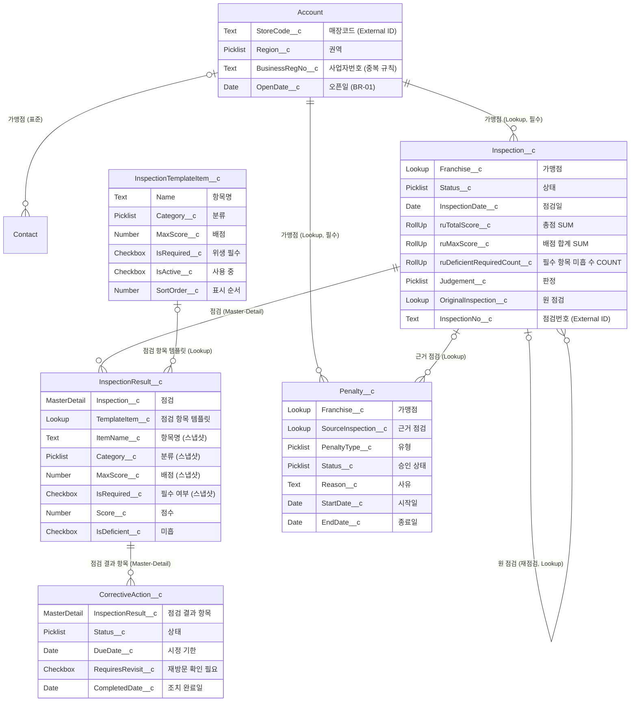

# ERD (데이터 모델)

| 항목     | 내용                                                                 |
| -------- | -------------------------------------------------------------------- |
| 문서번호 | 02. 가맹점 점검관리_ERD                                              |
| 버전     | V0.2                                                                 |
| 작성일자 | 2026.10.02                                                           |
| 프로젝트 | 가맹점 정기점검 관리 — ㈜한끼정성 (SFDC 개발자 온보딩 개인 프로젝트) |
| 작성자   | 이은석(Kai)                                                          |

## 변경 이력

| 버전 | 변경일자   | 작성자 | 변경 내용                                                                                                                                                                               |
| ---- | ---------- | ------ | --------------------------------------------------------------------------------------------------------------------------------------------------------------------------------------- |
| V0.1 | 2026.10.02 | Kai    | 초안 작성 (오브젝트 목록, 관계 7건)                                                                                                                                                     |
| V0.2 | 2026.10.06 | Kai    | 대안 B(가맹점 ↔ 점검 Lookup) 확정. 리뷰 반영: 템플릿/결과 항목 위치 교정, 시정조치 이중 부모 제거, 페널티 부모를 가맹점으로 변경, 재점검 자기 참조 추가. 3~7장은 Claude 초안 → Kai 검토 |

---

## 1. 다이어그램

---

## 2. 오브젝트 목록

| #   | Label            | API Name                    | 용도                                              | OWD                  | Record Type                                                 |
| --- | ---------------- | --------------------------- | ------------------------------------------------- | -------------------- | ----------------------------------------------------------- |
| 1   | 가맹점           | `Account` (표준)            | 매장. 소유자 = 담당 SV                            | Private              | -                                                           |
| 2   | 담당자           | `Contact` (표준)            | 가맹점주·점장 연락처                              | Controlled by Parent | -                                                           |
| 3   | 점검             | `Inspection__c`             | 매장 1회 방문 점검. 소유자 = 배정된 SV 또는 Queue | Private (계층 허용)  | 정기 `Regular` · 불시 `Unannounced` · 재점검 `Reinspection` |
| 4   | 점검 결과 항목   | `InspectionResult__c`       | 점검 1건의 항목별 점수. 템플릿 값을 스냅샷        | Controlled by Parent | -                                                           |
| 5   | 점검 항목 템플릿 | `InspectionTemplateItem__c` | 본사 점검표 양식 (항목·배점·필수)                 | **Public Read Only** | -                                                           |
| 6   | 시정조치         | `CorrectiveAction__c`       | 미흡 항목별 시정 요청과 기한                      | Controlled by Parent | -                                                           |
| 7   | 페널티           | `Penalty__c`                | 경고·공급 제한·해지 검토. 승인 대상               | Private (계층 허용)  | -                                                           |

- **템플릿이 Public Read Only인 이유**: 모든 SV가 점검 입력 시 양식을 읽어야 한다. 수정은 권한 집합 `점검표 관리` 보유자만 (오브젝트 권한으로 제어).
- **페널티 소유자**: 해당 가맹점 담당 SV(Account 소유자). 계층으로 권역팀장도 보고, 승인은 Approval Process 승인자(권역팀장·영업관리팀장)가 한다.

## 3. 관계 설계와 근거

| 부모             | 자식             | 관계 유형         | 선택 근거                                                                                                                                                                                                                                              |
| ---------------- | ---------------- | ----------------- | ------------------------------------------------------------------------------------------------------------------------------------------------------------------------------------------------------------------------------------------------------ |
| 가맹점           | 담당자           | Lookup (표준)     | 표준 관계. Account 삭제 시 Contact도 함께 삭제되고, 가시성은 `Controlled by Parent`로 가맹점을 따른다                                                                                                                                                  |
| 가맹점           | 점검             | **Lookup (필수)** | 점검마다 **담당 SV(소유자)가 필요**하다 — 매월 자동 생성 후 SV 배정, 미배정 점검 Queue(PDF), 오늘의 방문 목록(SC-01). M-D면 소유자가 사라져 셋 다 불가. 대가: 가맹점 화면의 점검 건수는 Roll-Up 대신 Apex로 집계(D4). 가맹점 삭제는 점검이 있으면 차단 |
| 점검             | 점검 결과 항목   | **Master-Detail** | 점검 없는 점수는 의미가 없다(삭제 연동). 점검 화면에 총점이 필요하다(Roll-Up). 결과 항목은 점검의 권한을 따라 SV 간 비공개가 자동 충족된다                                                                                                             |
| 점검 항목 템플릿 | 점검 결과 항목   | Lookup            | 같은 항목의 **3회 연속 미흡(BR-08)을 판단할 키**. 항목명은 문구가 바뀌면 비교가 깨지므로 레코드 참조가 필요하다. 템플릿을 비활성화해도 과거 결과는 남는다                                                                                              |
| 점검 결과 항목   | 시정조치         | **Master-Detail** | 시정은 "미흡 **항목별**" 요청이다(PDF). 결과 항목이 없으면 시정조치도 없다. 권한은 점검까지 따라 올라간다                                                                                                                                              |
| 가맹점           | 페널티           | **Lookup (필수)** | 페널티는 **매장이 받는 것**이다. 3회 연속 지적·불합격 2회 연속(BR-08)은 점검 여러 건에 걸친 조건이라 점검 1건을 부모로 할 수 없다. 이의제기 근거로 남아야 하므로 가맹점 삭제에 연동시키지 않는다                                                       |
| 점검             | 페널티           | Lookup (선택)     | 페널티를 발생시킨 마지막 점검을 근거로 연결. 근거 추적용이며 소유 관계는 아니다                                                                                                                                                                        |
| 점검             | 점검 (자기 참조) | Lookup            | 재점검(Record Type `Reinspection`)이 어느 점검의 재방문인지 연결. 자기 자신에게는 M-D를 걸 수 없다                                                                                                                                                     |

**의도된 비정규화 — 스냅샷**: 결과 항목에 항목명·분류·배점·필수 여부를 복사한다. 템플릿 Lookup만 두면 양식이 바뀔 때 과거 점검의 점수 기준까지 바뀐다. BR-11 "양식이 바뀌어도 과거 점검은 당시 항목·배점 유지" 때문에 **참조(Lookup)와 복사(스냅샷)를 둘 다** 둔다.

**SV 재배치 대응 (대안 B의 대가)**: 점검·페널티 소유자는 점검한 SV라, 담당이 바뀌면 새 SV가 과거 이력을 못 본다(As-Is "이력 단절"과 같은 문제). 1차: 재배치 시 Account와 해당 매장 점검·페널티 소유자를 Data Loader로 함께 이전(배포 절차서). D5: Account 소유자 변경 트리거로 자동 이전 검토.

## 4. Roll-Up Summary

| 대상(부모) 필드                             | 집계 자식      | 집계 방식          | 조건                                               | 용도                                                               |
| ------------------------------------------- | -------------- | ------------------ | -------------------------------------------------- | ------------------------------------------------------------------ |
| `Inspection__c.ruTotalScore__c`             | 점검 결과 항목 | SUM(`Score__c`)    | 없음                                               | 총점 (BR-02 판정)                                                  |
| `Inspection__c.ruMaxScore__c`               | 점검 결과 항목 | SUM(`MaxScore__c`) | 없음                                               | 당시 양식 기준 배점 합계. 양식이 바뀌어 100점이 아니어도 판정 가능 |
| `Inspection__c.ruDeficientRequiredCount__c` | 점검 결과 항목 | COUNT              | `IsRequired__c = TRUE` AND `IsDeficient__c = TRUE` | 위생 필수 항목 미흡 → 총점 무관 불합격 (BR-03)                     |

판정(`Judgement__c`)은 Roll-Up 두 값을 보고 **Apex**가 정한다(D4 서비스 클래스). 기준값 80/60점은 Custom Metadata(D6).

## 5. Validation Rule

| #   | 오브젝트       | Rule Name                      | 막는 상황                                       | 오류 메시지                            |
| --- | -------------- | ------------------------------ | ----------------------------------------------- | -------------------------------------- |
| 1   | 점검 결과 항목 | `ScoreWithinMaxScore`          | 점수가 0 미만이거나 배점을 넘을 때              | 점수는 0 이상, 배점 이하로 입력하세요. |
| 2   | 점검           | `ReinspectionRequiresOriginal` | Record Type이 재점검인데 원 점검이 비어 있을 때 | 재점검은 원래 점검을 지정해야 합니다.  |

BR-04 "미흡 항목 사진 필수"는 첨부 파일 유무를 Validation Rule로 확인할 수 없어 D3 Screen Flow에서 처리한다.

## 6. External ID

| 오브젝트 | 필드                       | 용도                                                                |
| -------- | -------------------------- | ------------------------------------------------------------------- |
| 가맹점   | `StoreCode__c` (Unique)    | Data Loader upsert 기준. 점검 이관 시 가맹점을 매장코드로 연결 (D3) |
| 점검     | `InspectionNo__c` (Unique) | 점검 200건 upsert. 재실행해도 중복 생성되지 않음                    |

## 7. 권한 매트릭스 반영 필요 사항

| 항목               | 내용                                                                                                                                          |
| ------------------ | --------------------------------------------------------------------------------------------------------------------------------------------- |
| 조회전용 공유 규칙 | 현재 Account만 있음. **점검·페널티에도** `경영진 열람` Read Only 공유 규칙 추가 (결과 항목·시정조치는 부모를 따름, 템플릿은 Public Read Only) |
| Queue              | `미배정 점검`은 점검(Lookup 유지로 소유자 있음)에 그대로 적용 가능                                                                            |
| M-D 자식 생성      | 결과 항목·시정조치를 만들려면 부모 점검에 Edit 권한 필요. SV는 담당 점검 소유자라 충족                                                        |
